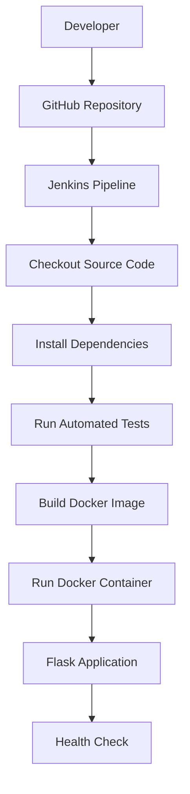
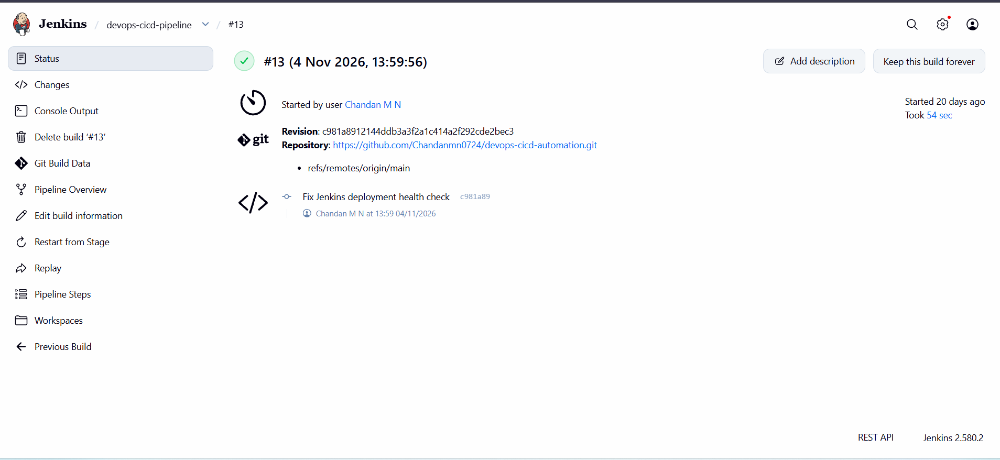
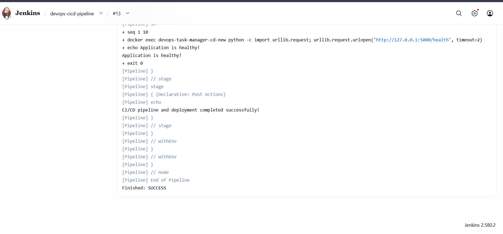
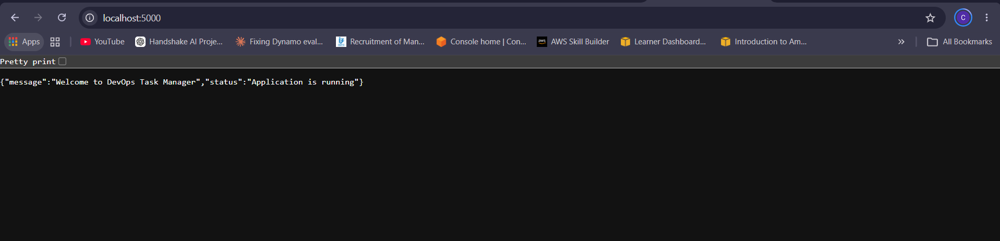
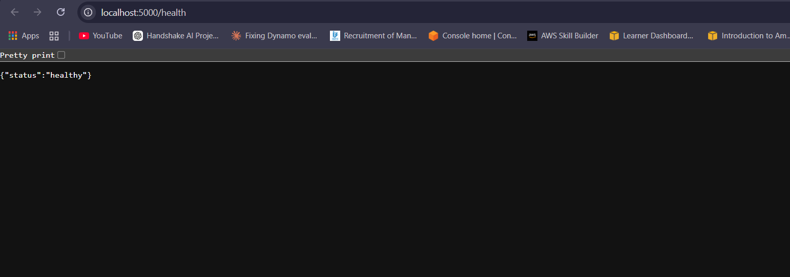

# DevOps CI/CD Automation

<p align="center">
  <strong>Automated Build and Testing Workflow using Jenkins, Docker and Python</strong>
</p>

<p align="center">
  
  
  
  
  
  
</p>

---

## 1. Project Overview

This project demonstrates a **CI/CD automation workflow** for a Python Flask application using Jenkins and Docker.

The application is integrated with a Jenkins pipeline that automates source code checkout, dependency installation and test execution.

Docker is used to package and run the Flask application inside a container, providing a consistent and isolated runtime environment.

The main objective of this project is to understand practical DevOps concepts, CI/CD pipeline execution, containerization and automated testing.

## 2. Technology Stack

| Technology | Purpose |
|---|---|
| Python 3.12 | Backend application development |
| Flask | Web application framework |
| Jenkins | CI/CD pipeline automation |
| Docker | Application containerization |
| Pytest | Automated testing |
| Git | Version control |
| GitHub | Source code management |
| Ubuntu Linux | Development environment |

## 3. System Architecture

The following diagram illustrates the project's workflow.



## 4. Key Features

- Jenkins-based CI/CD pipeline.
- Automated source code checkout from GitHub.
- Python dependency installation.
- Automated test execution using Pytest.
- Docker-based application containerization.
- Flask application with API endpoints.
- Application health-check endpoint.
- Linux-based development and execution environment.

## 5. Project Structure

```text
devops-cicd-automation/
│
├── app/
│   └── app.py
│
├── tests/
│   └── test_app.py
│
├── screenshots/
│   ├── jenkins-pipeline.png
│   ├── jenkins-console.png
│   ├── docker-app-response.png
│   └── docker-health-check.png
│
├── Dockerfile
├── docker-compose.yml
├── Jenkinsfile
├── requirements.txt
└── README.md
```

## 6. Jenkins CI/CD Pipeline

Jenkins is used to automate the application's build and testing workflow.

### Pipeline stages

| Stage | Description |
|---|---|
| Checkout | Retrieves the source code from GitHub |
| Install Dependencies | Installs the required Python packages |
| Run Tests | Executes automated tests using Pytest |

The pipeline uses a Python Docker environment for dependency installation and test execution.

### Pipeline Execution

The Jenkins pipeline can be configured to execute when changes are made to the connected GitHub repository.

A successful pipeline execution confirms that the configured stages have completed successfully.

## 7. Docker Containerization

Docker is used to package the Flask application and its dependencies into a container.

This helps maintain a consistent application environment and makes it easier to run the application across different systems.

### Build Docker Image

```bash
docker build -t devops-task-manager .
```

### Run Docker Container

```bash
docker run -d -p 5001:5000 --name devops-task-manager devops-task-manager
```

### Check Running Containers

```bash
docker ps
```

### Stop the Container

```bash
docker stop devops-task-manager
```

## 8. Application API Endpoints

| Endpoint | Description |
|---|---|
| `/` | Returns the application welcome message |
| `/health` | Checks application health |
| `/tasks` | Task management endpoint |

### Application Response

```json
{
  "message": "Welcome to DevOps Task Manager",
  "status": "Application is running"
}
```

### Health Check Response

```json
{
  "status": "healthy"
}
```

## 9. Project Screenshots

### 9.1 Jenkins Pipeline

Shows the Jenkins pipeline execution and its stages.



### 9.2 Jenkins Console Output

Shows the pipeline execution logs.



### 9.3 Docker Application Response

Shows the Flask application running through Docker.



### 9.4 Application Health Check

Shows the application's health-check response.



## 10. Run the Project Locally

### Prerequisites

Make sure the following tools are installed:

- Python 3.12 or above
- Git
- Docker Desktop
- Jenkins (for CI/CD pipeline execution)

### Step 1: Clone the Repository

```bash
git clone https://github.com/ChandanMN0724/devops-cicd-automation.git
```

```bash
cd devops-cicd-automation
```

### Step 2: Build the Docker Image

```bash
docker build -t devops-task-manager .
```

### Step 3: Run the Application

```bash
docker run -d -p 5001:5000 --name devops-task-manager devops-task-manager
```

### Step 4: Access the Application

Open the following address in your browser:

```text
http://localhost:5001
```

Health check:

```text
http://localhost:5001/health
```

### Step 5: Run Tests Locally

Install dependencies:

```bash
pip install -r requirements.txt
```

Execute tests:

```bash
pytest
```

## 11. Learning Outcomes

Through this project, I gained practical experience in:

- Understanding CI/CD concepts and Jenkins pipeline execution.
- Building and managing Docker images and containers.
- Automating Python application testing using Pytest.
- Working with Git and GitHub repositories.
- Understanding application health checks.
- Working with Linux and Docker-based development environments.
- Understanding the integration of development and operations workflows.

## 12. Future Enhancements

- Implement automated deployment to a cloud platform.
- Integrate code quality and security scanning.
- Publish Docker images to Docker Hub through Jenkins.
- Introduce application monitoring and centralized logging.
- Add pipeline notifications for build status.


## 13. Author

**Chandan M N**

B.E. – Artificial Intelligence and Data Science

<p align="left">
  <a href="https://github.com/ChandanMN0724">
    
  </a>
  <a href="https://www.linkedin.com/in/chandanmn07">
    
  </a>
</p>


**Email:** [mnchandan605@gmail.com](mailto:mnchandan605@gmail.com)

---

<div align="center">
  <p><strong>Built with Python, Jenkins and Docker.</strong></p>
  <p><em>Learning by building practical DevOps projects.</em></p>
</div>


