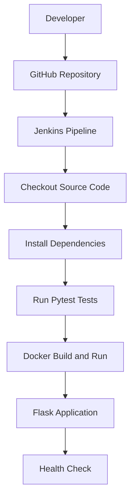

# DevOps CI/CD Automation

<p align="center">
  <strong>Automated Build, Test and Deployment Workflow using Jenkins, Docker and Python</strong>
</p>

<p align="center">
  
  
  
  
  
  
</p>

---

## 1. Project Overview

This project demonstrates a **CI/CD automation workflow** for a Python Flask application using Jenkins and Docker.

The application is integrated with a Jenkins pipeline that automates repository checkout, dependency installation and test execution. Docker is used to package the application into a container, providing a consistent runtime environment.

The project helped me gain practical experience with CI/CD pipelines, containerization, automated testing and application health monitoring.

## 2. Technology Stack

| Technology | Purpose |
|---|---|
| Python 3.12 | Application development |
| Flask | Backend web framework |
| Jenkins | CI/CD pipeline automation |
| Docker | Application containerization |
| Pytest | Automated testing |
| Git & GitHub | Version control and source code |
| Linux / Ubuntu | Development environment |

## 3. System Architecture

The following diagram represents the main workflow:



## 4. Key Features

- Automated source code checkout from GitHub.
- Jenkins pipeline for CI/CD workflow execution.
- Python dependency installation.
- Automated test execution using Pytest.
- Docker-based application containerization.
- Flask REST API endpoints.
- Application health-check endpoint.
- Verification of application availability.

## 5. Project Structure

```text
devops-cicd-automation/
│
├── app/
│   └── app.py
│
├── tests/
│   └── test_app.py
│
├── screenshots/
│   ├── jenkins-pipeline.png
│   ├── jenkins-console.png
│   ├── docker-app-response.png
│   └── docker-health-check.png
│
├── Dockerfile
├── docker-compose.yml
├── Jenkinsfile
├── requirements.txt
└── README.md
```

## 6. CI/CD Pipeline

The Jenkins pipeline automates the application's build and testing workflow.

### Pipeline stages

| Stage | Description |
|---|---|
| Checkout | Retrieves source code from GitHub |
| Install Dependencies | Installs Python dependencies |
| Run Tests | Executes automated tests using Pytest |

The pipeline uses a Python Docker environment for dependency installation and test execution.

## 7. Application API Endpoints

| Endpoint | Description |
|---|---|
| `/` | Returns the application welcome message |
| `/health` | Checks application health |
| `/tasks` | Task management endpoint |

### Health Check Response

```json
{
  "status": "healthy"
}
```

## 8. Project Screenshots

### Jenkins Pipeline


### Jenkins Console Output


### Docker Application Response


### Application Health Check


## 9. Run the Project Locally

### Prerequisites

- Python 3.12+
- Git
- Docker Desktop
- Jenkins (for pipeline execution)

### Step 1: Clone the repository

```bash
git clone https://github.com/ChandanMN0724/devops-cicd-automation.git

cd devops-cicd-automation
```

### Step 2: Build the Docker image

```bash
docker build -t devops-task-manager .
```

### Step 3: Run the container

```bash
docker run -d -p 5001:5000 --name devops-task-manager devops-task-manager
```

### Step 4: Verify the application

Open your browser:

```text
http://localhost:5001
```

Health check:

```text
http://localhost:5001/health
```

### Step 5: Run tests

```bash
pip install -r requirements.txt
pytest
```

## 10. Learning Outcomes

Through this project, I gained practical experience in:

- Understanding CI/CD concepts and Jenkins pipeline execution.
- Building and running Docker containers.
- Automating Python application testing.
- Working with GitHub repositories and source control.
- Understanding application health checks.
- Working with Linux and Docker-based development environments.

## 11. Future Improvements

- Integrate automated deployment to a cloud platform.
- Add code quality and security scanning.
- Implement Docker image publishing to Docker Hub.
- Introduce monitoring and logging.
- Add pipeline notifications.

## 12. Author

**Chandan M N**

B.E. – Artificial Intelligence and Data Science

- GitHub: [ChandanMN0724](https://github.com/ChandanMN0724)
- LinkedIn: [Connect with me](https://www.linkedin.com/in/chandanmn07)
- Email: mnchandan605@gmail.com

---

<p align="center">
  <strong>Built to explore DevOps, CI/CD automation and containerization.</strong>
</p>
