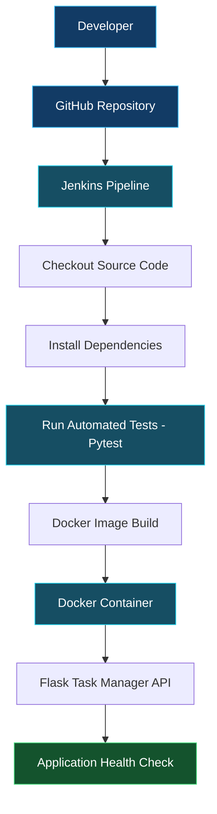

<div align="center">


<br/>


<br/><br/>

**Automating application testing and containerization with Jenkins and Docker.**

</div>

---

## 📌 Project Overview

DevOps CI/CD Automation is a project that demonstrates the development and automation of a Python Flask-based Task Manager application.

The application is containerized using Docker and integrated with Jenkins to automate the development and testing workflow. Pytest is used for automated testing, while Docker provides a consistent environment for running the application.

The project demonstrates practical concepts of application development, containerization, CI/CD automation and deployment.

## 🎯 Project Objectives

- Develop a Python Flask-based Task Manager application.
- Create REST API endpoints for application functionality.
- Containerize the application using Docker.
- Configure Jenkins for CI/CD automation.
- Automate application testing using Pytest.
- Work with application deployment and health checks.

---

## 🏗️ System Architecture



---

## 🛠️ Technologies Used

| Technology | Purpose |
|---|---|
| Python 3.12 | Application development |
| Flask | REST API backend |
| Docker | Application containerization |
| Jenkins | CI/CD pipeline automation |
| Pytest | Automated testing |
| Gunicorn | Python application server |
| Linux | Development environment |
| Git & GitHub | Version control and source code management |
| Docker Compose | Container management |

---

## 📂 Project Structure

```text
devops-cicd-automation/
│
├── app/
│   └── Application source code
│
├── tests/
│   └── Automated test cases
│
├── Dockerfile
├── Jenkinsfile
├── docker-compose.yml
├── requirements.txt
├── .dockerignore
└── .gitignore
```

---

## ⚙️ CI/CD Pipeline

The project uses Jenkins to automate important stages of the application workflow.

### Pipeline Stages

**1. Source Code Checkout**

- Retrieves the application source code from GitHub.
- Provides the source code required for the pipeline.

**2. Install Dependencies**

- Installs the required Python dependencies.
- Prepares the environment for application testing.

**3. Automated Testing**

- Executes test cases using Pytest.
- Helps verify application functionality.

**4. Docker Image Build**

- Builds a Docker image for the Flask application.
- Packages the application and its dependencies.

**5. Deployment and Health Checks**

- Uses the configured deployment process.
- Checks application availability through its health endpoint.

---

## 🚀 Getting Started

Follow these steps to run the project locally.

### 1. Clone the Repository

```bash
git clone https://github.com/ChandanMN0724/devops-cicd-automation.git

cd devops-cicd-automation
```

### 2. Build the Docker Image

```bash
docker build -t devops-task-manager .
```

### 3. Run the Docker Container

```bash
docker run -d -p 5001:5000 --name devops-task-manager devops-task-manager
```

### 4. Verify Application Health

```bash
curl http://localhost:5001/health
```

### 5. Run Automated Tests

Install dependencies:

```bash
pip install -r requirements.txt
```

Execute tests:

```bash
pytest
```

---

## 🔗 Application Endpoints

The Flask application includes the following endpoints:

| Endpoint | Description |
|---|---|
| `/` | Application home endpoint |
| `/health` | Application health check |
| `/tasks` | Task management endpoint |

---

## 📸 Project Screenshots

Screenshots of the application, Docker containers and Jenkins pipeline execution will be added here.

| Component | Screenshot |
|---|---|
| Jenkins Pipeline | Coming soon |
| Docker Container | Coming soon |
| Flask Application | Coming soon |

---

## 📚 Key Learning Outcomes

- Understanding CI/CD pipeline concepts.
- Building and managing Docker images and containers.
- Automating Python application testing with Pytest.
- Integrating GitHub with Jenkins.
- Working with Flask REST APIs.
- Understanding application deployment and health checks.
- Working with Linux and containerized environments.

---

## 👨‍💻 About the Developer

**Chandan M N**

B.E. Graduate in Artificial Intelligence and Data Science  
Srinivas Institute of Technology

Interested in Python Development, Backend Engineering, Software Development and DevOps.

<div align="center">

<a href="https://github.com/ChandanMN0724">

</a>

<a href="https://www.linkedin.com/in/chandanmn07">

</a>

<a href="mailto:mnchandan605@gmail.com">

</a>

<br/><br/>


**BUILD • AUTOMATE • DEPLOY • IMPROVE**

</div>
